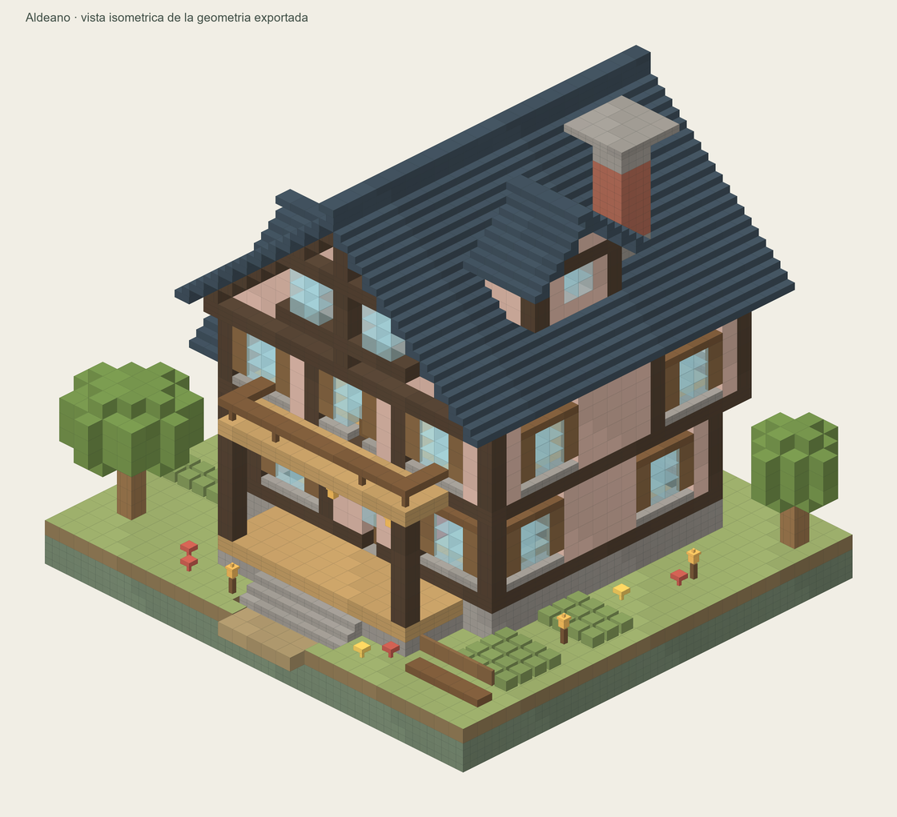
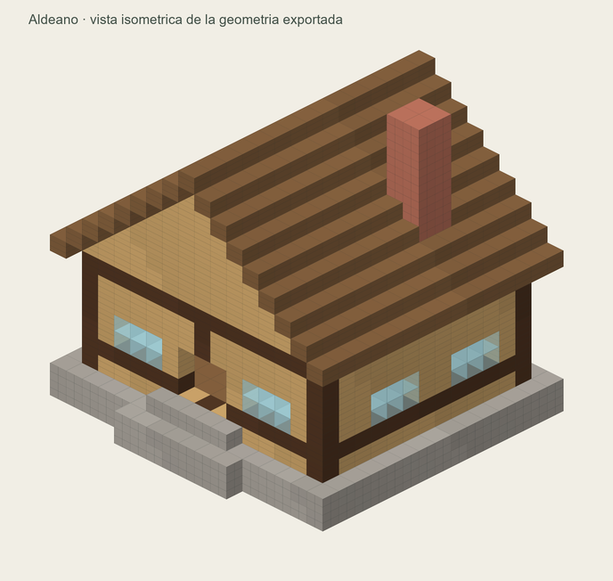
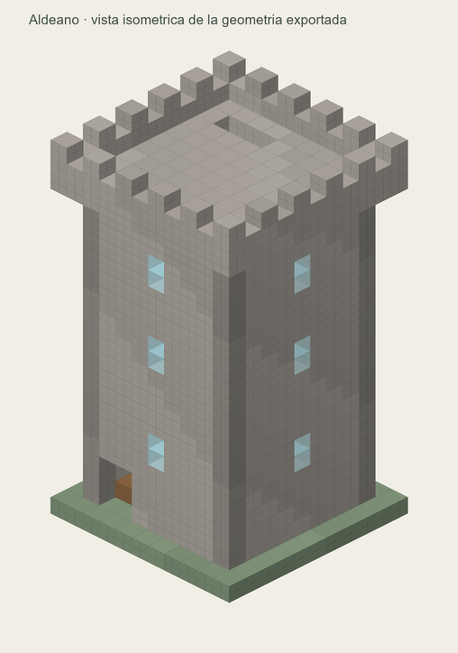
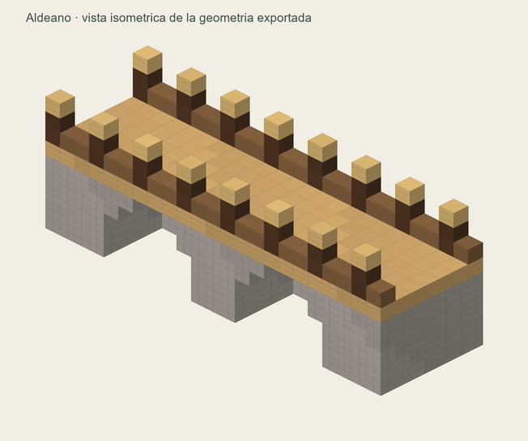

# Aldeano Build Generator

**Pega el kit en una IA, responde unas preguntas y genera una construcción para Minecraft.**

Versión de prueba **v0.2.0** · Python estándar · Bedrock y Java · Sin API keys.

> Los archivos pasan comprobaciones técnicas y se leen con un lector NBT independiente.
> La carga dentro de Minecraft y las sesiones en ChatGPT Free/Claude Free están pendientes.
> Esta primera versión sirve para realizar esas pruebas.

## Probar con una IA

Copia este mensaje en ChatGPT o Claude:

~~~text
Usa este repositorio para ayudarme a generar una construcción de Minecraft:
https://github.com/Aldeanoo/aldeano-build-generator

Lee el kit completo:
https://raw.githubusercontent.com/Aldeanoo/aldeano-build-generator/v0.2.0/INICIO_IA.txt

Sigue sus instrucciones y pregúntame solo lo que falte:
qué construir y estilo, edición/dispositivo, tamaño y detalles.
Después usa el generador incluido y entrégame los archivos descargables.
Si no puedes leer el kit o ejecutar código, dímelo; no inventes una descarga.
~~~

Si la IA no consigue leerlo, **[descarga INICIO_IA.txt](https://github.com/Aldeanoo/aldeano-build-generator/releases/download/v0.2.0/INICIO_IA.txt) y adjúntalo**, o copia todo su contenido en la conversación. Es un único archivo autosuficiente: instrucciones, catálogo, ejemplo y código. No necesitas adjuntar este plan ni todo el repositorio.

La IA debería preguntar, en un mensaje:

1. ¿Qué quieres construir y con qué estilo?
2. ¿Bedrock, Java o ambos? ¿En qué dispositivo y versión?
3. ¿Pequeño, mediano o medidas concretas?
4. ¿Qué interiores o detalles quieres?

Puedes responder **«decide tú»**. Para entregar binarios, la sesión debe permitir ejecutar código y crear archivos. Sin esas herramientas conservará el diseño JSON y explicará la limitación. El kit no activa funciones que la cuenta no tenga.

[Estado de las pruebas de proveedores](docs/provider-tests.md).

[Ver el flujo completo con un ejemplo de conversaci?n](docs/flujo.md) ? [M?todo interno y fuentes](docs/generation-design.md).

Si estabas usando el primer kit, adjunta el TXT actualizado y pide sustituir las dos copias de c?digo. Una conversaci?n que conserve v0.1.0 seguir? generando con sus limitaciones.

## Probar directamente en Minecraft

Nuevo ejemplo destacado: una posada con balc?n, buhardilla, chimenea, interior y jard?n.

[Descargar la posada completa](https://github.com/Aldeanoo/aldeano-build-generator/releases/download/v0.2.0/posada_del_roble.todo.zip).

Hay cuatro construcciones ya generadas:

| Ejemplo | Tamaño | Vista | Descarga completa |
| --- | --- | --- | --- |
| Posada detallada | 31 ? 32 ? 29 | [Preview](samples/posada_del_roble/preview.svg) | [Posada](https://github.com/Aldeanoo/aldeano-build-generator/releases/download/v0.2.0/posada_del_roble.todo.zip) |
| Casa medieval | 19 × 19 × 17 | [Preview](samples/casa_medieval/preview.svg) | [Casa](https://github.com/Aldeanoo/aldeano-build-generator/releases/download/v0.2.0/casa_medieval.todo.zip) |
| Torre de vigía | 13 × 24 × 13 | [Preview](samples/torre_vigia/preview.svg) | [Torre](https://github.com/Aldeanoo/aldeano-build-generator/releases/download/v0.2.0/torre_vigia.todo.zip) |
| Puente rústico | 23 × 9 × 11 | [Preview](samples/puente_rustico/preview.svg) | [Puente](https://github.com/Aldeanoo/aldeano-build-generator/releases/download/v0.2.0/puente_rustico.todo.zip) |

Cada ZIP contiene la estructura y el pack para ambas ediciones, el diseño reutilizable, materiales, preview y LEEME.txt. También puedes descargar los archivos sueltos desde [samples/](samples/).

Las previews son proyecciones esquemáticas; no son capturas del juego.

### Bedrock

En Windows, importa el `.mcstructure` desde un bloque de estructura:

~~~text
/give @s structure_block
~~~

Cambia el bloque a Cargar, importa el archivo y carga.

Alternativa: abre el `.mcpack` con Minecraft, activa el behavior pack en el mundo y ejecuta:

~~~text
/structure load aldeano:casa_medieval ~ ~ ~
~~~

[Guía Bedrock](docs/bedrock.md). La importación directa por botón requiere Windows y ser anfitrión. Móvil pendiente de prueba; consola sin importación directa prometida.

### Java

Los ejemplos publicados usan **Java 26.3**. Copia `casa_medieval.datapack.zip` dentro de `datapacks/` en la carpeta de tu mundo, carga el mundo o ejecuta `/reload` y después:

~~~text
/place template aldeano:casa_medieval ~ ~ ~
~~~

No copies `.todo.zip` como datapack. Para Java 1.21.1 hay que regenerar con su perfil.
[Guía Java](docs/java.md). Los comandos requieren permisos en el mundo.

## Generar localmente — opción para desarrollo

Python 3.10 o posterior. No requiere instalar paquetes:

~~~text
python generator.py examples/posada.request.json --edition both --output output
~~~

Para Java 1.21.1:

~~~text
python generator.py examples/casa_medieval.build.json --edition java --java-profile java-1.21.1 --output output-java121
~~~

Opciones: `--edition bedrock|java|both`, `--max-size 32|48`, `--pack-version 1.0.1`, `--overwrite` y `--catalog`. Por defecto no sobrescribe salidas existentes.

El nombre del diseño conserva la identidad del pack Bedrock. Para actualizarlo, aumenta su versión; en la IA se explica este paso automáticamente.

## Qué genera

- Bedrock: `.mcstructure` v1 little-endian y `.mcpack`.
- Java: `.nbt` GZIP big-endian y `.datapack.zip`.
- JSON reutilizable, materiales, validación estructural, preview SVG y guía.
- ZIP general opcional para conservarlo todo.

37 entradas de catálogo: 36 materiales completos y aire. Soporta `set` y `fill`, tamaños hasta 32 por eje por defecto y hasta 48 mediante opción explícita. Los límites no son los límites universales de Minecraft.

No incluye entidades, inventarios, agua, redstone ni bloques de mods.
La celda sin escribir conserva el mundo; el aire explícito vacía.
[Esquema JSON](schema/aldeano-build-v1.schema.json) · [Catálogo](catalog/canonical.json).

## Estado técnico y pruebas

40 pruebas automatizadas: validación y límites, coordenadas asimétricas,
aire/omisión, ambas versiones Java, paletas Bedrock, empaquetado,
reproducibilidad y ejecución del kit aislado con `python -S`.

~~~text
python -m pip install -r requirements-dev.txt
python -m unittest discover -s tests -v
python tools/build_ai_bundle.py --check
~~~

El runtime no necesita las dependencias de desarrollo. El PNG de los ejemplos se rasteriza opcionalmente con Pillow; la ejecuci?n del kit genera SVG sin instalar paquetes.
La plantilla de GitHub Actions está en `.github/ci-template.yml`. No está activada:
la conexión usada para publicar tiene permiso de repositorio, pero carece del scope
`workflow`. Para activarla, colócala en `.github/workflows/ci.yml` desde una conexión
con ese permiso. Las 40 pruebas se han ejecutado localmente.
El kit ocupa aproximadamente **16.908 tokens con o200k_base**; otros proveedores tokenizan de otra forma.

[Compatibilidad y fuentes](docs/compatibility.md) · [Resultados locales](docs/test-results.md) · [Plan](plan.md).

## Contribuir o reportar un fallo

Incluye versión del juego, plataforma, perfil elegido, mensaje de error y diseño JSON.
Para fallos del chat: proveedor, método de entrada y si había ejecución de código.
No publiques datos privados de tu cuenta.

Las fuentes del kit están en instructions/ y generator.py. Tras cambiarlas, ejecuta:

~~~text
python tools/build_ai_bundle.py
~~~

Licencia MIT. Proyecto independiente de Mojang/Microsoft.
